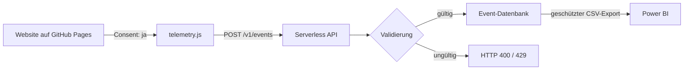

# Telemetrie-Pipeline für die Pizzeria am Medienhafen

Stand: 30. Juli 2026  
Ziel: datensparsame Auswertung von sechs Website-Ereignissen in Power BI  
Status: technische Implementierungsvorlage, keine Rechtsberatung

## 1. Entscheidung für die erste Version

Die erste Version erfasst ausschließlich:

- `menu_opened`
- `pizza_clicked`
- `call_button_clicked`
- `navigation_clicked`
- `gallery_opened`
- `reservation_started`

Der Browser sendet pro Ereignis nur diese zwei Felder:

```json
{
  "event": "call_button_clicked",
  "page": "/"
}
```

Der Server ergänzt den Empfangszeitpunkt. In der Analysedatenbank stehen damit nur:

```json
{
  "received_at": "2026-07-30T20:15:43Z",
  "event": "call_button_clicked",
  "page": "/"
}
```

Nicht erhoben oder gespeichert werden:

- IP-Adresse
- Cookie- oder Local-Storage-ID
- Sitzungs- oder Besucher-ID
- User-Agent, Browser oder Betriebssystem
- Bildschirmgröße oder Geräteklasse
- Referrer oder Suchbegriff
- Standort
- Fingerprint
- vollständige Ziel-URL eines angeklickten Links
- frei eingegebene Daten

Damit lassen sich Ereignisse zählen, aber weder einzelne Personen noch Besuche oder
Klickfolgen wiedererkennen. Diese Einschränkung ist beabsichtigt.

## 2. Antwort auf die Einwilligungsfrage

Die Eventnamen allein entscheiden nicht darüber, ob eine Einwilligung erforderlich ist.
Entscheidend sind die gesamte technische Verarbeitung, der Zweck und die eingesetzten
Speicher- oder Auslesetechniken.

Für die Umsetzung wird deshalb folgende konservative Regel verwendet:

> Analyse-Events werden erst versendet, nachdem der Nutzer „Anonyme Statistik“
> zugestimmt hat.

Das ist für diese freiwillige Reichweiten- und Verhaltensanalyse die rechtlich
risikoärmste Variante. Die Website muss auch bei Ablehnung vollständig funktionieren.

Warum diese Vorsicht trotz nur `event` und `page` sinnvoll ist:

1. Beim HTTP-Aufruf des Telemetrie-Endpunkts wird technisch mindestens die IP-Adresse
   an den empfangenden Server übermittelt, auch wenn die Anwendung sie nicht in der
   Datenbank speichert.
2. Browser und Infrastruktur können automatisch weitere Header oder Logs erzeugen.
3. § 25 TDDDG verlangt grundsätzlich eine Einwilligung, wenn auf Informationen in der
   Endeinrichtung zugegriffen oder dort Informationen gespeichert werden; die Ausnahme
   gilt insbesondere für unbedingt erforderliche Vorgänge.
4. Die sechs Events sind für die vom Nutzer gewünschte Darstellung der Website nicht
   erforderlich, sondern dienen der Analyse.

Eine Variante ohne Consent-Banner sollte erst nach einer Prüfung der konkreten
Implementierung, des Hosters, sämtlicher Logs und der Rechtsgrundlage eingesetzt
werden. „Ohne Cookies“ bedeutet nicht automatisch „ohne DSGVO“ oder
„ohne Einwilligung“.

Relevante Primär- und Behördenquellen:

- [§ 25 TDDDG – Schutz der Privatsphäre bei Endeinrichtungen](https://www.gesetze-im-internet.de/ttdsg/__25.html)
- [Art. 6 und Art. 13 DSGVO – Rechtsgrundlage und Informationspflichten](https://eur-lex.europa.eu/eli/reg/2016/679/art_6/oj)
- [BfDI: Digitale Dienste und Zuständigkeiten](https://www.bfdi.bund.de/DE/Buerger/Inhalte/Telemedien/Telemedien.html)
- [BfDI: Webseiten-Analysetool Matomo](https://www.bfdi.bund.de/DE/Fachthemen/Inhalte/Telemedien/Matomo.html)
- [EuGH, C-582/14 – dynamische IP-Adressen](https://eur-lex.europa.eu/legal-content/EN/CASE/?uri=CELEX%3A62014CJ0582)
- [DSK: Orientierungshilfe für Anbieter von Telemedien](https://www.datenschutzkonferenz-online.de/media/oh/20211220_oh_telemedien.pdf)

Vor dem Produktivstart sind Datenschutzerklärung, Einwilligungstext,
Auftragsverarbeitungsvertrag und tatsächliche Log-Einstellungen zu prüfen.

## 3. Architektur

GitHub Pages ist statisch und kann keine eingehenden Events in eine JSON-Datei
schreiben. Deshalb wird ein separater HTTPS-Endpunkt benötigt.



### Konkrete Empfehlung

Für einen schnellen Start:

- Collector: `js/telemetry.js` auf der bestehenden Website
- API: kleine Serverless Function
- Datenbank: SQL-Datenbank mit EU-Region, wenn der Anbieter dies garantiert
- Export: geschützter CSV-Endpunkt für Power BI

Mögliche Plattformen sind beispielsweise Cloudflare Worker plus D1, Supabase in
einer gewählten EU-Region oder ein eigener kleiner Dienst auf einem EU-Server. Die
Plattform ist erst nach Prüfung von Region, Unterauftragnehmern, Löschfristen,
Serverlogs, Auftragsverarbeitungsvertrag und Drittlandtransfer auszuwählen.

Für die Website wird im Folgenden neutral mit diesen URLs geplant:

```text
POST https://telemetry.example.de/v1/events
GET  https://telemetry.example.de/v1/export.csv
```

## 4. Ereignisdefinitionen

Ein Event braucht eine eindeutige fachliche Bedeutung. Andernfalls werden Zahlen
später nicht vergleichbar.

| Event | Auslöser | Maximal einmal? | Hinweis zum aktuellen Stand |
|---|---|---:|---|
| `menu_opened` | Der Bereich `#menu` ist erstmals mindestens 50 % sichtbar | pro Seitenaufruf | Nicht bei jedem Tabwechsel erneut zählen |
| `pizza_clicked` | Nutzer aktiviert ein tatsächlich anklickbares Pizza-Element | nein | Aktuell sind Speisekarteneinträge überwiegend keine eigenen Links oder Buttons; erst nach Einbau einer echten Interaktion erfassen |
| `call_button_clicked` | Klick auf einen Link mit `href^="tel:"` außerhalb der Rechtstexte | nein | Navbar-, Kontakt- und Floating-CTA zählen gleich |
| `navigation_clicked` | Klick auf einen internen Navigationslink in Navbar oder Footer | nein | Wegen des Minimalmodells wird das Ziel nicht gespeichert |
| `gallery_opened` | Der Bereich `#gallery` ist erstmals mindestens 50 % sichtbar | pro Seitenaufruf | Wenn später ein Lightbox-Dialog existiert, stattdessen dessen Öffnung zählen |
| `reservation_started` | Klick auf einen echten Reservierungs-CTA | nein | Derzeit ist kein eindeutiger Reservierungsprozess vorhanden; nicht mit einem normalen Telefonklick doppelt zählen |

„Maximal einmal pro Seitenaufruf“ wird nur im Arbeitsspeicher der geladenen Seite
umgesetzt, zum Beispiel mit einem JavaScript-`Set`. Dafür wird weder Cookie noch
Local Storage benötigt. Nach Neuladen der Seite beginnt die Zählung neu.

### Wichtige Einschränkungen des Minimalmodells

- `page` ist bei der aktuellen One-Page-Website fast immer `/`.
- Ohne zusätzliches Feld wie `target` kann `navigation_clicked` nicht nach
  „Speisekarte“, „Galerie“ und „Kontakt“ aufgeteilt werden.
- Ohne `pizza_id` zeigt `pizza_clicked` nur die Gesamtzahl aller Pizza-Klicks.
- Ohne Besucher- oder Sitzungs-ID kann keine Conversion-Rate
  „Reservierung pro Besucher“ berechnet werden.
- Eine Summe von Events ist keine Besucherzahl.

Diese Grenzen sollten nicht unbemerkt durch spätere Identifikatoren umgangen werden.
Eine Schemaerweiterung ist eine neue Datenschutzentscheidung.

## 5. Datenvertrag

### Request

```http
POST /v1/events HTTP/1.1
Content-Type: text/plain;charset=UTF-8
Origin: https://pam-pizzeria-am-medienhafen.de

{"event":"menu_opened","page":"/"}
```

`text/plain` vermeidet bei diesem einfachen Request einen CORS-Preflight. Der Server
muss den Text trotzdem strikt als JSON parsen und validieren.

### Erlaubte Werte

```js
const ALLOWED_EVENTS = new Set([
  'menu_opened',
  'pizza_clicked',
  'call_button_clicked',
  'navigation_clicked',
  'gallery_opened',
  'reservation_started'
]);
```

Für `page` gilt in Version 1:

```text
/
/about/
```

Query-Parameter und Hash-Fragmente werden niemals übertragen. Dadurch gelangen
beispielsweise Kampagnenparameter oder versehentlich sensible URL-Inhalte nicht in
die Datenbank.

### Response

Bei Erfolg:

```http
HTTP/1.1 204 No Content
Cache-Control: no-store
```

Bei ungültigen Daten:

```http
HTTP/1.1 400 Bad Request
Cache-Control: no-store
```

Der Response enthält keine Eventdaten.

## 6. Datenbankschema

```sql
CREATE TABLE telemetry_events (
    id          INTEGER PRIMARY KEY,
    received_at TEXT NOT NULL DEFAULT (strftime('%Y-%m-%dT%H:%M:%fZ', 'now')),
    event       TEXT NOT NULL CHECK (
        event IN (
            'menu_opened',
            'pizza_clicked',
            'call_button_clicked',
            'navigation_clicked',
            'gallery_opened',
            'reservation_started'
        )
    ),
    page        TEXT NOT NULL CHECK (page IN ('/', '/about/'))
);

CREATE INDEX idx_telemetry_received_at
    ON telemetry_events(received_at);

CREATE INDEX idx_telemetry_event_received_at
    ON telemetry_events(event, received_at);
```

Die ID ist nur ein technischer Primärschlüssel des Datensatzes und keine Nutzer-ID.

### Aufbewahrung

Startwert: Rohereignisse nach 90 Tagen löschen. Vor dem Löschen können ausschließlich
Tagessummen erhalten bleiben:

```sql
CREATE TABLE telemetry_daily (
    day         TEXT NOT NULL,
    event       TEXT NOT NULL,
    page        TEXT NOT NULL,
    event_count INTEGER NOT NULL,
    PRIMARY KEY (day, event, page)
);
```

Löschjob:

```sql
DELETE FROM telemetry_events
WHERE received_at < datetime('now', '-90 days');
```

Die konkrete Frist muss in der Datenschutzerklärung mit der tatsächlichen
Konfiguration übereinstimmen.

## 7. Browser-Collector

Geplante Datei: `js/telemetry.js`

```js
(() => {
  'use strict';

  const ENDPOINT = 'https://telemetry.example.de/v1/events';
  const ALLOWED_EVENTS = new Set([
    'menu_opened',
    'pizza_clicked',
    'call_button_clicked',
    'navigation_clicked',
    'gallery_opened',
    'reservation_started'
  ]);
  const ALLOWED_PAGES = new Set(['/', '/about/']);
  const sentOnce = new Set();

  function hasAnalyticsConsent() {
    return window.pamConsent?.analytics === true;
  }

  function normalizedPage() {
    const path = window.location.pathname;
    return ALLOWED_PAGES.has(path) ? path : '/';
  }

  function track(event, { once = false } = {}) {
    if (!hasAnalyticsConsent() || !ALLOWED_EVENTS.has(event)) return;
    if (once && sentOnce.has(event)) return;

    const body = JSON.stringify({
      event,
      page: normalizedPage()
    });

    if (once) sentOnce.add(event);

    fetch(ENDPOINT, {
      method: 'POST',
      mode: 'cors',
      credentials: 'omit',
      cache: 'no-store',
      keepalive: true,
      headers: {
        'Content-Type': 'text/plain;charset=UTF-8'
      },
      body
    }).catch(() => {});
  }

  window.pamTelemetry = Object.freeze({ track });
})();
```

Wichtige Eigenschaften:

- kein Cookie und kein Local Storage im Collector
- `credentials: 'omit'`
- keine Warteschlange mit Nutzerkennung
- keine Übertragung vor Einwilligung
- kein Retry, der Klicks mehrfach zählen könnte
- keine Übertragung von URL-Query oder Hash
- `credentials: 'omit'` verhindert das Senden von Cookies und HTTP-Zugangsdaten
- Fehler blockieren niemals Navigation oder Telefonanruf

### Consent-Schnittstelle

Die tatsächliche Consent-Lösung muss eine jederzeit widerrufbare Entscheidung
abbilden. Der Collector erwartet lediglich:

```js
window.pamConsent = Object.freeze({
  analytics: true
});
```

Die Speicherung der Consent-Entscheidung selbst greift auf die Endeinrichtung zu.
Zweck, Inhalt und Speicherdauer dieser Einstellung müssen im Consent-Dialog erklärt
werden. Vor Einwilligung darf `analytics` nicht `true` sein.

## 8. Einbindung in die bestehende Website

In `index.html` wird der Collector vor `js/script.js` mit `defer` eingebunden:

```html
<script defer src="js/consent.js?v=1"></script>
<script defer src="js/telemetry.js?v=1"></script>
<script defer src="js/script.js?v=51"></script>
```

### Telefonklick

Event Delegation verhindert, dass jeder vorhandene Telefonlink einzeln angepasst
werden muss:

```js
document.addEventListener('click', event => {
  const link = event.target.closest('a[href^="tel:"]');
  if (!link || link.closest('[role="dialog"]')) return;
  window.pamTelemetry?.track('call_button_clicked');
});
```

### Navigation

Die Selektoren sollten auf die echte Haupt-, Mobil- und Footer-Navigation begrenzt
werden, nicht auf jeden Ankerlink:

```js
document
  .querySelectorAll('#navbar a[href^="#"], footer a[href^="#"]')
  .forEach(link => {
    link.addEventListener('click', () => {
      window.pamTelemetry?.track('navigation_clicked');
    });
  });
```

### Speisekarte und Galerie sichtbar

```js
function trackSectionOnce(selector, eventName) {
  const section = document.querySelector(selector);
  if (!section || !('IntersectionObserver' in window)) return;

  const observer = new IntersectionObserver(entries => {
    if (!entries.some(entry => entry.isIntersecting && entry.intersectionRatio >= 0.5)) {
      return;
    }

    window.pamTelemetry?.track(eventName, { once: true });
    observer.disconnect();
  }, { threshold: [0.5] });

  observer.observe(section);
}

trackSectionOnce('#menu', 'menu_opened');
trackSectionOnce('#gallery', 'gallery_opened');
```

Falls keine Einwilligung vorliegt, darf der Observer getrennt werden, ohne das Event
später nachträglich zu senden. Wird während eines laufenden Seitenaufrufs eingewilligt,
soll nur eine anschließend neu auftretende Interaktion erfasst werden.

### Pizza und Reservierung

Diese Events werden erst eingebaut, wenn die Website dafür echte Bedienelemente hat:

```html
<button type="button" data-telemetry-event="pizza_clicked">
  Pizza Margherita ansehen
</button>

<a href="https://reservierung.example/" data-telemetry-event="reservation_started">
  Reservieren
</a>
```

```js
document.addEventListener('click', event => {
  const control = event.target.closest('[data-telemetry-event]');
  if (!control) return;
  window.pamTelemetry?.track(control.dataset.telemetryEvent);
});
```

Es wird bewusst weder Pizzaname noch Reservierungsanbieter übertragen.

## 9. Anforderungen an den API-Endpunkt

Der Endpunkt muss:

1. ausschließlich `POST` akzeptieren;
2. nur den exakten Origin
   `https://pam-pizzeria-am-medienhafen.de` per CORS freigeben;
3. Request Bodies auf höchstens 256 Bytes begrenzen;
4. nur die zwei Schlüssel `event` und `page` akzeptieren;
5. Typ, Länge und Allowlist beider Werte prüfen;
6. `received_at` ausschließlich serverseitig setzen;
7. keine IP-Adresse und keinen User-Agent in die Eventtabelle übernehmen;
8. Response- und Anwendunglogs ohne Request Body betreiben;
9. Datenbankfehler nicht an den Client ausgeben;
10. `Cache-Control: no-store` setzen;
11. eine angemessene Rate-Begrenzung vorsehen;
12. Export und Administration getrennt authentifizieren.

CORS ist kein Schutz gegen absichtlich gefälschte Requests außerhalb eines Browsers.
Deshalb sind Allowlist, Größenlimit und Rate-Begrenzung weiterhin erforderlich.

### Infrastruktur-Logs

„Die Anwendung speichert keine IP“ reicht nicht aus. Zusätzlich sind zu kontrollieren:

- CDN- und Firewall-Logs
- Serverless Invocation Logs
- Access Logs
- Datenbank-Audit-Logs
- Error-Tracking
- Backups

Wo Logs technisch unvermeidbar sind, sind Zweck, Zugriff, Kürzung und Löschfrist zu
dokumentieren. Telemetrie-Request-Bodies dürfen nicht in Diagnose- oder Fehlerlogs
landen.

## 10. Geschützter Export für Power BI

Der Export-Endpunkt darf nicht öffentlich sein. Er liefert nur die benötigten Spalten:

```csv
received_at,event,page
2026-07-30T20:15:43.000Z,call_button_clicked,/
2026-07-30T20:18:10.000Z,menu_opened,/
```

Authentifizierung:

```http
GET /v1/export.csv?from=2026-07-01&to=2026-07-31
Authorization: Bearer <EXPORT_TOKEN>
```

Der Token liegt nur als Secret im API-Dienst und als geschützte Datenquellen-
Anmeldeinformation in Power BI. Er wird niemals in Git, JavaScript oder einer
öffentlichen URL gespeichert.

Beispiel für Power Query:

```powerquery
let
    BaseUrl = "https://telemetry.example.de/v1/export.csv",
    Source = Csv.Document(
        Web.Contents(
            BaseUrl,
            [
                Query = [
                    from = "2026-07-01",
                    to = "2026-07-31"
                ],
                Headers = [
                    Authorization = "Bearer " & TelemetryExportToken
                ]
            ]
        ),
        [Delimiter = ",", Encoding = 65001, QuoteStyle = QuoteStyle.Csv]
    ),
    Headers = Table.PromoteHeaders(Source, [PromoteAllScalars = true]),
    Types = Table.TransformColumnTypes(
        Headers,
        {
            {"received_at", type datetimezone},
            {"event", type text},
            {"page", type text}
        }
    )
in
    Types
```

`TelemetryExportToken` wird als Power-BI-Parameter verwaltet und nicht in eine
veröffentlichte `.pbix`-Datei eingebettet, die unkontrolliert weitergegeben wird.

## 11. Sinnvolle Power-BI-Kennzahlen

Mit Version 1 sind möglich:

- Events pro Stunde, Tag, Woche und Monat
- Anzahl der Menüöffnungen
- Anzahl der Telefonklicks
- Anzahl der Galerieöffnungen
- Anzahl begonnener Reservierungen
- Verhältnis eines Events zu einem anderen Event im selben Zeitraum
- Entwicklung der Eventzahlen über die Zeit

Beispiel-DAX:

```DAX
Events =
COUNTROWS ( Telemetry )
```

```DAX
Anrufklicks =
CALCULATE (
    [Events],
    Telemetry[event] = "call_button_clicked"
)
```

```DAX
Menüöffnungen =
CALCULATE (
    [Events],
    Telemetry[event] = "menu_opened"
)
```

```DAX
Anrufklicks je 100 Menüöffnungen =
DIVIDE ( [Anrufklicks], [Menüöffnungen], 0 ) * 100
```

Die letzte Kennzahl ist keine Nutzer-Conversion-Rate. Zähler und Nenner können von
unterschiedlichen Personen oder Seitenaufrufen stammen.

Mit Version 1 ausdrücklich nicht möglich:

- eindeutige Besucher
- Sitzungen
- Neu- gegenüber Wiederkehrern
- Mobile gegenüber Desktop
- Browser oder Betriebssystem
- Herkunft über Google, Instagram oder Direktaufruf
- Suchbegriffe
- individuelle Navigation oder Funnel
- Verweildauer

## 12. Datenschutzerklärung und Consent-Text

Die Datenschutzerklärung muss vor Produktivstart mindestens beschreiben:

- Verantwortlichen und Kontakt
- Zweck: anonyme beziehungsweise datensparsame Nutzungsstatistik
- konkrete Daten: Eventtyp, Seitenpfad, serverseitiger Empfangszeitpunkt sowie
  technisch unvermeidbare Verbindungsdaten beim Transport
- Rechtsgrundlage
- Empfänger und Auftragsverarbeiter
- Hostingregion und gegebenenfalls Drittlandtransfer
- Speicherdauer für Rohdaten, Logs und Backups
- Widerrufsmöglichkeit
- Betroffenenrechte

Muster für die Oberfläche, nach rechtlicher Prüfung anzupassen:

> **Anonyme Statistik**  
> Mit Ihrer Einwilligung zählen wir ausgewählte Interaktionen wie das Öffnen der
> Speisekarte oder einen Klick auf die Telefonnummer. Wir verwenden dafür keine
> Werbeprofile und keine besuchsübergreifende Kennung. Die Website funktioniert
> auch ohne diese Statistik. Sie können Ihre Entscheidung jederzeit ändern.

Schaltflächen müssen gleichwertig erreichbar sein:

- „Ablehnen“
- „Anonyme Statistik erlauben“
- Link zu Details und späterem Widerruf

Vor Zustimmung wird kein Analyse-Event versendet.

## 13. Tests vor dem Produktivstart

### Funktion

- Zustimmung: Ein definierter Klick erzeugt genau einen Datensatz.
- Ablehnung: Es wird kein Request an den Telemetrie-Endpunkt gesendet.
- Widerruf: Ab Widerruf werden keine weiteren Events gesendet.
- `menu_opened` und `gallery_opened`: höchstens einmal pro Seitenaufruf.
- Telefonlink: öffnet weiterhin ohne merkliche Verzögerung die Telefon-App.
- Fehler oder Timeout der API: Website funktioniert unverändert.

### Datenminimierung

Im Browser-Netzwerk-Tab prüfen:

- Body enthält exakt `event` und `page`.
- Keine Query-Parameter oder Hash-Fragmente.
- Keine Cookies im Request.
- Kein Auth-Token im öffentlichen Collector.

In API, Datenbank und Plattform prüfen:

- keine IP in der Eventtabelle;
- kein User-Agent in der Eventtabelle;
- kein Request Body in Logs;
- keine automatisch aktivierte Langzeitprotokollierung;
- Backups folgen der Löschfrist.

### Sicherheit

- unbekanntes Event ergibt `400`;
- zusätzliche JSON-Felder ergeben `400`;
- unbekannter Pfad ergibt `400`;
- Body über 256 Bytes ergibt `413`;
- falscher Origin erhält keine CORS-Freigabe;
- Export ohne oder mit falschem Token ergibt `401`;
- CSV-Felder werden sicher serialisiert;
- Rate-Limit reagiert mit `429`;
- Secrets sind nicht in Git enthalten.

### Beispiel-Testfälle

```text
GÜLTIG:
{"event":"menu_opened","page":"/"}

UNGÜLTIG – unbekanntes Event:
{"event":"email_entered","page":"/"}

UNGÜLTIG – zusätzliches Feld:
{"event":"menu_opened","page":"/","userId":"123"}

UNGÜLTIG – Query im Pfad:
{"event":"menu_opened","page":"/?utm_source=instagram"}
```

## 14. Umsetzungsplan für morgen

### Phase 1 – Festlegen

- [ ] Hostinganbieter und EU-Region auswählen.
- [ ] Auftragsverarbeitungsvertrag und Log-Einstellungen prüfen.
- [ ] API- und Export-Domain festlegen.
- [ ] Aufbewahrungsfrist bestätigen.
- [ ] Datenschutzerklärung und Consent-Text rechtlich prüfen.

### Phase 2 – Backend

- [ ] Datenbank und Tabellen anlegen.
- [ ] `POST /v1/events` implementieren.
- [ ] strikte Schema- und Origin-Prüfung implementieren.
- [ ] Request-Body-Limit und Rate-Limit aktivieren.
- [ ] Logs und Fehlermeldungen minimieren.
- [ ] 90-Tage-Löschjob einrichten.
- [ ] geschützten CSV-Export implementieren.
- [ ] Export-Token als Secret hinterlegen.

### Phase 3 – Website

- [ ] `js/consent.js` erstellen.
- [ ] `js/telemetry.js` erstellen.
- [ ] Skripte mit `defer` einbinden.
- [ ] `call_button_clicked` integrieren.
- [ ] `navigation_clicked` integrieren.
- [ ] `menu_opened` und `gallery_opened` integrieren.
- [ ] `pizza_clicked` erst an ein echtes Pizza-Bedienelement binden.
- [ ] `reservation_started` erst an einen eindeutigen Reservierungs-CTA binden.
- [ ] Datenschutzerklärung aktualisieren.
- [ ] sichtbare Möglichkeit zum Widerruf ergänzen.

### Phase 4 – Prüfung

- [ ] Tests aus Abschnitt 13 ausführen.
- [ ] mit Ablehnung im Browser-Netzwerk-Tab prüfen: null Telemetrie-Requests.
- [ ] mit Zustimmung alle sechs definierten Interaktionen prüfen.
- [ ] Datenbank auf unerwünschte Spalten und Inhalte prüfen.
- [ ] Plattformlogs manuell kontrollieren.
- [ ] CSV-Export und Power-BI-Aktualisierung testen.
- [ ] nach Deployment erneut auf der echten Domain prüfen.

## 15. Abnahmekriterien

Die erste Version ist fertig, wenn:

1. vor Einwilligung kein Event gesendet wird;
2. bei Ablehnung alle Website-Funktionen unverändert nutzbar sind;
3. die Datenbank ausschließlich Zeitpunkt, Event und erlaubten Seitenpfad enthält;
4. keine Nutzer-, Geräte-, Sitzungs- oder Wiedererkennungskennung existiert;
5. Infrastruktur- und Anwendunglogs dokumentiert und minimiert sind;
6. Rohdaten automatisch nach der festgelegten Frist gelöscht werden;
7. der Power-BI-Export authentifiziert und nicht öffentlich ist;
8. Datenschutzerklärung und Consent-Oberfläche der realen Verarbeitung entsprechen;
9. die sechs Events nach den Definitionen in Abschnitt 4 getestet sind.

## 16. Spätere Erweiterungen

Jede Erweiterung wird vor dem Einbau einzeln bewertet. Besonders kritisch sind:

- `visitor_id` oder `session_id`
- Cookies oder Local Storage zur Wiedererkennung
- Referrer und UTM-Parameter
- User-Agent oder Geräteklasse
- vollständige URL
- IP-Kürzung oder IP-Hash statt vollständigem Verzicht
- Verweildauer und Scrolltiefe
- externe Analyse-, Werbe- oder Error-Tracking-Dienste

Ein Hash einer IP-Adresse ist nicht automatisch anonym. Bei kleinem Suchraum und
bekannten Zusatzinformationen kann eine Zuordnung weiterhin möglich sein. Für die
erste Version wird deshalb keine solche Kennung erzeugt.
